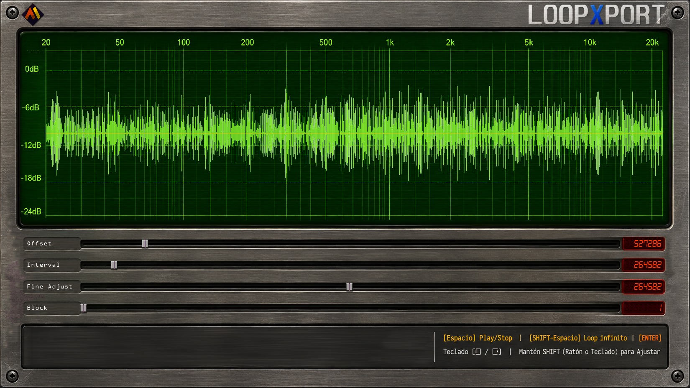

# LoopXPort Pro 🎛️⚡



**LoopXport Pro** es una herramienta interactiva de precisión quirúrgica de audio desarrollada en Python y Pygame. Está diseñada específicamente para productores musicales, sound designers y DJs que necesitan extraer bloques rítmicos estáticos perfectos (como bucles de 4 compases o estructuras 4x4) a partir de archivos WAV o MP3. 

El núcleo del programa incluye una interfaz gráfica acelerada por hardware (GPU) y un motor de audio de baja latencia con **reproducción continua 100% libre de baches (*gapless loop*)**, permitiendo ajustar el tamaño de los intervalos muestra a muestra en tiempo real.

---

## 🔥 Características Principales

* **Fondo Sin Marcos (*Borderless & No Frame*):** Se ejecuta a pantalla completa adaptándose de forma nativa a la resolución de tu monitor. Maximiza el rango horizontal del ratón para lograr un control absoluto.
* **Geometría de Onda Estática y Rellena:** Visualización sólida de la onda (*DAW Style*) con escala vertical congelada respecto al pico global absoluto. La onda se desliza como una cinta continua de forma firme y predecible.
* **Descarte Inicial Inteligente (Offset):** Slider de desplazamiento para ignorar silencios, intros o desajustes antes del primer golpe rítmico, con rango suficiente para saltar bloques enteros.
* **Motor de Audio Gapless Perpetuo:** Implementado mediante callbacks nativos en `sounddevice` a través de un hilo secundario de máxima prioridad. Permite alterar los cortes en caliente sin baches acústicos ni clics.
* **Control Quirúrgico con SHIFT:** Modificador de sensibilidad que desmultiplica el movimiento tanto del ratón como del teclado por 10 (ajuste hiperfino de décimas de muestra).
* **Pantalla de Carga Estilizada (Splash Backdrop):** Muestra una imagen de fondo con transparencia (*Alpha canal*) integrada mientras decodifica el audio estáticamente a la memoria RAM.
* **Tipografía Monoespaciada Coherente:** El uso de fuentes monoespaciadas garantiza que las métricas y la telemetría rítmica permanezcan estables y legibles sin oscilar.

---

## 🛠️ Requisitos e Instalación

Este proyecto es totalmente compatible con **Python 3.13** y versiones superiores (incluye parches para módulos obsoletos como `audioop`).

1. **Clona el repositorio:**
   ```bash
   git clone https://github.com/pinakure/loopxport.git
   cd loopxport
   ```

2. **Instala las dependencias necesarias:**
   ```bash
   pip install -r requirements.txt
   ```

3. **Instalación de FFmpeg (Obligatorio para procesar MP3):**
   * **Windows:** Descarga FFmpeg y añade su carpeta `bin` a las Variables de Entorno del Sistema (`PATH`).
   * **Mac:** `brew install ffmpeg`
   * **Debian:** `sudo apt install ffmpeg`
   * **Arch:** `sudo pacman install ffmpeg`

---

## 🚀 Modo de Uso

Arrastra tu archivo de audio a la carpeta del script o indica su ruta a través de la terminal al ejecutar el archivo principal:

```bash
python loopxport.py "ruta/de/tu_audio.mp3"
```

También puedes cargar el audio con valores de intervalo y offset preestablecidos:

```bash
python loopxport.py "ruta/de/tu_audio.mp3" 248732 2138983
```

### ⌨️ Mapeo de Controles y Teclado

| Control / Tecla | Acción |
| :--- | :--- |
| **Arrastrar con Ratón** | Modifica el valor de los Sliders (Offset, Intervalo, Bloque). |
| **Ratón + `SHIFT`** | Desmultiplica el movimiento del slider por 10 (Ajuste Quirúrgico). |
| **`Flecha Derecha` / `Izquierda`** | Añade o quita muestras al intervalo de tamaño actual. |
| **`SHIFT` + `Flechas`** | Ajuste micro-fino de muestras por teclado (pasos de `0.1` muestras). |
| **`Espacio`** | Reproduce el bloque seleccionado bajo inspección una sola vez (*One-shot*). |
| **`SHIFT` + `Espacio`** | **Reproducción Gapless en Bucle Infinito** para verificar el tempo real. |
| **`Escape (ESC)`** | Botón de pánico para cerrar instantáneamente el programa sin marcos. |
| **`Enter (RETURN)`** | Cierra la interfaz, confirma el periodo y **exporta secuencialmente todos los loops en formato WAV**. |

---

## 📂 Estructura del Proyecto

```text
loopxport/
│
├── loopxport.py       # Script principal y orquestador del bucle de eventos
├── ui.py              # Módulo visual de Pygame (sliders, render sólido de onda y panel)
├── audio.py           # Motor gapless y callback en streaming de sounddevice
└── backdrop.png       # (Opcional) Imagen de fondo translúcida para la pantalla de carga
```

---

## ⚙️ Flujo de Trabajo para un Corte Perfecto

1. Carga la pista y mantén el selector en el **Bloque 1**.
2. Mueve el slider de **Offset** (puedes usar `SHIFT` para máxima precisión) hasta que el primer golpe de bombo coincida exactamente con el borde izquierdo de la pantalla.
3. Activa el bucle infinito con **`SHIFT + ESPACIO`**.
4. Modifica el **Tamaño del Intervalo** con el slider general y el de ajuste fino hasta que el ritmo de la canción sea idéntico y estable a lo largo del tiempo.
5. Salta al último bloque con el slider de inspección. Si los transitorios de la onda coinciden en la cuadrícula visual de forma idéntica al primer bloque, el periodo es correcto.
6. Presiona **`ENTER`** y recoge tus muestras perfectamente cortadas.
